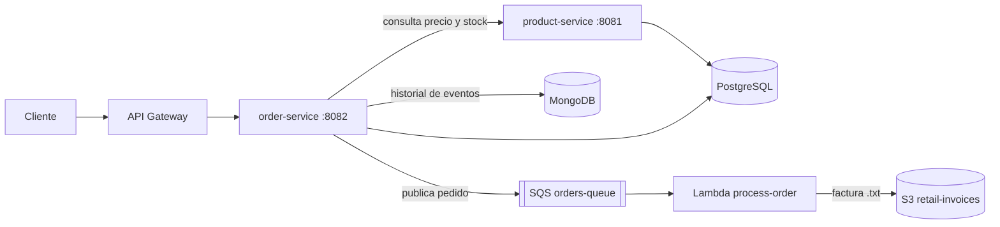

# RetailFlow

Plataforma de pedidos para el sector **retail**, construida con microservicios en Java. Un cliente crea un pedido y el procesamiento posterior (factura, historial de eventos) ocurre de forma asíncrona.

> **Nota:** los servicios de AWS (API Gateway, SQS, Lambda, S3) corren **simulados con LocalStack** en local, sin cuenta ni costos de AWS.

## Arquitectura



## Tecnologías

| Tecnología | Uso en el proyecto |
|---|---|
| Java 17 + Spring Boot | Backend de los dos microservicios |
| SOLID + Clean Code | Capas controller → service → repository, interfaces y DTOs |
| REST | CRUD de productos y gestión de pedidos |
| Microservicios | `product-service` y `order-service`, comunicados por HTTP |
| PostgreSQL | Productos, pedidos y sus ítems |
| MongoDB | Historial de eventos de cada pedido |
| Docker / Docker Compose | Contenedores y orquestación local |
| AWS SQS | Cola de pedidos nuevos |
| AWS Lambda (Python) | Procesa cada pedido y genera la factura |
| AWS S3 | Almacena las facturas |
| AWS API Gateway | Punto de entrada público `POST /orders` |
| LocalStack | Emula los servicios de AWS en local |
| Kubernetes (Minikube) | *En progreso* |

## Cómo ejecutarlo

Requisitos: Docker Desktop y Git Bash (o cualquier shell con Bash).

```bash
git clone <URL_DEL_REPO> retailflow
cd retailflow

# 1. Levantar bases de datos, microservicios y LocalStack
docker compose up -d --build

# 2. Desplegar Lambda (crea también la cola SQS y el bucket S3)
./scripts/deploy-lambda.sh

# 3. Desplegar API Gateway
./scripts/deploy-apigateway.sh
```

El último script imprime el id de la API. LocalStack pierde su estado si se recrea el contenedor; en ese caso se repiten los pasos 2 y 3.

## Endpoints

**product-service** (`localhost:8081`)

| Método | Ruta | Descripción |
|---|---|---|
| GET | `/products` | Lista productos |
| GET | `/products/{id}` | Detalle de un producto |
| POST | `/products` | Crea un producto |
| PUT | `/products/{id}` | Actualiza un producto |
| DELETE | `/products/{id}` | Elimina un producto |

**order-service** (`localhost:8082`)

| Método | Ruta | Descripción |
|---|---|---|
| POST | `/orders` | Crea un pedido (valida stock y calcula el total) |
| GET | `/orders` | Lista pedidos |
| GET | `/orders/{id}` | Detalle de un pedido |
| PUT | `/orders/{id}/status?value=PAID` | Cambia el estado |
| GET | `/orders/{id}/events` | Historial de eventos (MongoDB) |

Estados: `CREATED`, `PAID`, `SHIPPED`, `DELIVERED`, `CANCELLED`.

## Ejemplo de uso

```bash
# Crear un producto
curl -X POST http://localhost:8081/products \
  -H "Content-Type: application/json" \
  -d '{"name":"Camiseta","description":"Algodon","price":49900,"stock":20}'

# Crear un pedido a través de API Gateway (reemplaza API_ID)
curl -X POST http://localhost:4566/restapis/API_ID/dev/_user_request_/orders \
  -H "Content-Type: application/json" \
  -d '{"customerName":"Alejandra","items":[{"productId":1,"quantity":2}]}'

# Marcar como pagado y ver el historial
curl -X PUT "http://localhost:8082/orders/1/status?value=PAID"
curl http://localhost:8082/orders/1/events

# Ver las facturas generadas por el Lambda
docker exec retail-localstack awslocal s3 ls s3://retail-invoices/invoices/
```

Respuesta de un pedido:

```json
{
  "id": 1,
  "customerName": "Alejandra",
  "status": "CREATED",
  "total": 99800.00,
  "items": [
    { "productId": 1, "productName": "Camiseta", "quantity": 2, "unitPrice": 49900.00 }
  ]
}
```

## Flujo de un pedido

1. El cliente envía `POST /orders` (directo o por API Gateway).
2. `order-service` consulta precio y stock a `product-service` y calcula el total.
3. Guarda el pedido en PostgreSQL y registra el evento `CREATED` en MongoDB.
4. Publica el pedido en la cola SQS.
5. Lambda lee la cola, genera la factura y la sube a S3.

## Decisiones técnicas

- **Dos bases de datos:** PostgreSQL para datos transaccionales y relacionales; MongoDB para el historial de eventos, que es append-only y de forma flexible.
- **Mensajería asíncrona:** un fallo de la cola no tumba la creación del pedido; solo se registra una advertencia.
- **Lambda en Python:** arranque mucho más rápido que en Java para una función pequeña.
- **LocalStack:** permite desarrollar y demostrar la integración con AWS sin costos.
- **Scripts de despliegue:** la infraestructura simulada se reconstruye con un comando.

## Próximos pasos

- [ ] Manifiestos de Kubernetes y despliegue en Minikube
- [ ] Despliegue en AWS real
- [ ] Pruebas automatizadas
- [ ] Facturas en PDF

## Autora

**Nury Alejandra Blanco** · [LinkedIn](https://linkedin.com/in/nury-alejandra-blanco-palomino-8428b0226) · [GitHub](https://github.com/AlejandraWhite)
